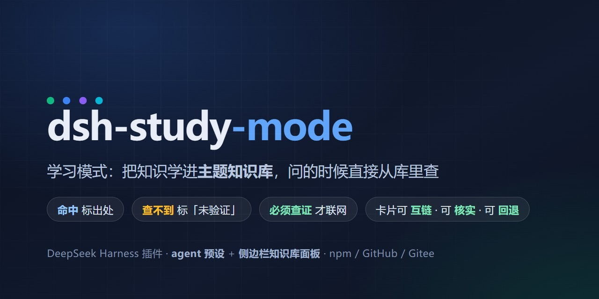
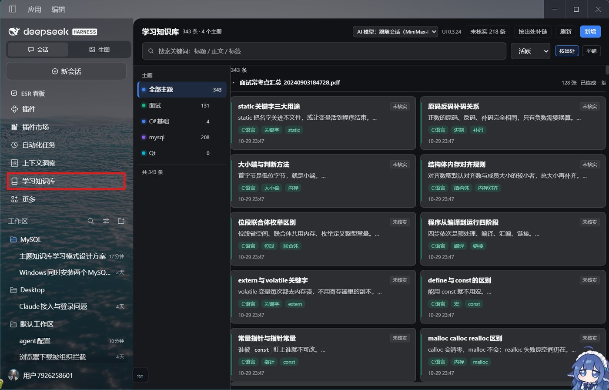
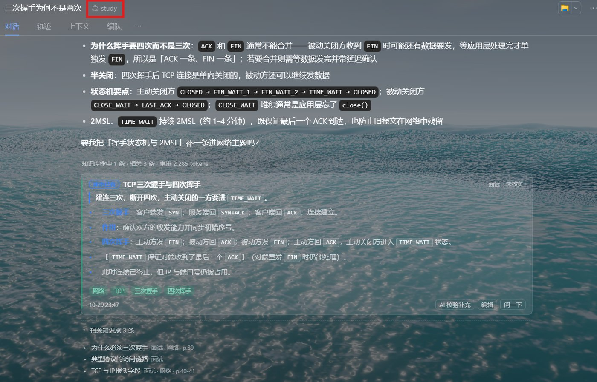
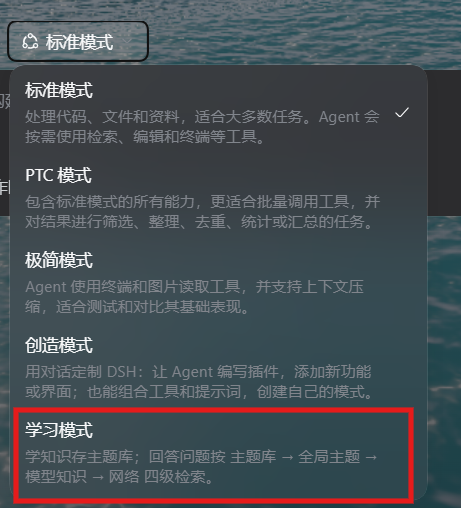

# dsh-study-mode

**学习模式（study-mode）**：把知识学进**主题知识库**，问的时候直接从库里查 —— **查到了标出处，查不到标「未验证」**。

[](https://www.npmjs.com/package/dsh-study-mode)
[](https://www.npmjs.com/package/dsh-study-mode)
[](https://github.com/waspqj/dsh-study-mode)
[](https://github.com/waspqj/dsh-study-mode/actions/workflows/ci.yml)
[](https://www.npmjs.com/package/dsh-study-mode)
[](https://github.com/topics/dsh-plugin)

> DeepSeek Harness (DSH) 插件 · agent 预设 + 侧边栏知识库面板
> `dsh-plugin` · `dsh-bundle` · `agent-preset` · `study-mode` · `knowledge-base` · `learning`

📖 中文介绍（掘金）：[DSH 插件「学习模式」：生成本地自己的知识库 联网验证避免AI幻觉](https://juejin.cn/post/7702914241568931875)
📖 中文介绍（CSDN）：[DSH 插件「学习模式」：生成本地自己的知识库 联网验证避免AI幻觉](https://blog.csdn.net/2502_91433987/article/details/169749354)
📚 已收录：[awesome-deepseek-harness-plugins](https://github.com/imsai-sh/awesome-deepseek-harness-plugins)（[收录 PR #784](https://github.com/imsai-sh/awesome-deepseek-harness-plugins/pull/784)）

一个包给你两样东西：

| | |
| --- | --- |
| **agent 预设「学习模式」** | 新建会话时选它。回答先查库 → 查不到用自己的知识（标「未验证」）→ 必须查证才联网（标日期） |
| **侧边栏「学习知识库」面板** | 书本图标：按主题浏览、搜索、互链、归档 / 恢复 / 删除 / 手动新增 / AI 校验补充 |

---

## 界面长什么样

### 侧边栏的知识库面板：按「出处」分组，同一份课件的卡连成一条线



- 左边是主题，**每个主题一个自己的颜色**；右边按**出处**分组 —— 同一份课件的知识点放在一起，组内按页码排（就是课件的顺序）
- 组头能一键「连成一组」，把这份课件的知识点连成一条链；右上角可切「平铺」
- 每张卡上有标题、摘要、标签、核实状态（未核实的会标出来）
- 顶部还能改插件自己的模型（AI 校验补充、检索重排用它）

### 回答里命中一张卡：出处标在卡上，相关知识点一并列出



- 命中卡片直接显示在回答下面，**出处、核实状态都在卡上**
- 「相关知识点 3 条」是卡片之间建好的关系网 —— 命中一条就知道它的邻居
- 卡上还有「AI 校验补充」「编辑」「问一下」三个动作

### 预设列表里多一个「学习模式」



选它开会话，模型就按「主题库 → 全局主题 → 模型知识 → 网络」四级检索回答。

---

## 它跟别的知识库插件差在哪

不是一个更大的功能清单，是三条取舍：

1. **查不到就标「未验证」，不装作知道。**
   库里没有 → 回答里明写「库里没有独立的 X 条目」，再给模型知识并标 `[模型知识·未验证]`，
   同时提议补一条。**宁可说没有，也不编一个像样的答案。**

2. **每条卡片都带出处。**
   来源是结构化的（文件 / 网页 / 用户口述 + 页码定位），卡片和回答里都能看到
   「这句是从哪来的」。数字、参数、命令跟原文对不上时，看卡片原文，不看模型的转述。

3. **卡片之间能互链。**
   正文里写 `[[另一张卡的标题]]` 就建成一条链接；详情里能看到「链接（它连着谁）」
   和「被引用（谁连着它）」。知识是网，不是一堆孤岛 —— 这条是本插件跟
   纯检索类插件最明显的差别。

## 一条真实的命中长什么样

问「间隙锁是什么」，库里命中的是这条（下面是从真实库里跑出来的原样结果）：

```json
{
  "title": "间隙锁(Gap Lock)",
  "topic": "mysql",
  "score": 72.34,
  "body": "锁的是索引记录之间的空隙，不是记录本身。\n- **间隙锁**罩住首记录前、末记录后的范围，阻止其他事务在其中插入。",
  "source": { "type": "file", "ref": "课件 06. 专题六：事务和锁(重点).pdf", "locator": "p.16-18" },
  "verified": true
}
```

回答里对应的是：

> **间隙锁**
> - 锁的是索引记录之间的空隙，不是记录本身。　[主题:间隙锁]
> - 罩住首记录前、末记录后的范围，阻止其他事务在其中插入。

出处（文件 + 页码）在卡片上，展开那张卡就能看到原文位置。

## 性能（338 张卡片的真实库实测）

| 操作 | 耗时 |
| --- | --- |
| 冷启动（读盘 + 建索引） | **7.8 ms** |
| 面板列全库条目 | **1.2 ms** |
| 单次检索（BM25，338 条） | **13.7 ms** |
| 算一张卡的正向 + 全库反向链接 | **2.7 ms** |

检索是纯本地计算，**不调模型、不联网、不上传任何东西**。
模型那一次往返才贵（见下面的「怎么问最省」）。

---

## 安装

命令行一条装（复制就能用）：

```bash
dsh plugin --profile web add dsh-study-mode
```

或者走图形界面：DSH 的「插件」页 →「添加插件」→「安装第三方插件」：

| 方式 | 填什么 | 注意 |
| --- | --- | --- |
| **npm 包名** | `dsh-study-mode` | 国内可在「安装源」选 npmmirror 镜像 |
| **GitHub 仓库** | `git+https://github.com/waspqj/dsh-study-mode.git` | 宿主认得 github.com，直接可用；**主发布源**，代码与 Gitee 一致 |
| **Gitee 仓库** | `git+https://gitee.com/waspqj/dsh-study-mode.git` | 国内访问快的一模一样的镜像；**必须带 `git+` 前缀**（裸地址会被当成 tarball，拉回 HTML 页面导致安装失败） |
| **tarball** | `https://…/dsh-study-mode-0.3.25.tgz` | 或本地绝对路径 |
| **本地目录** | `C:\path\to\dsh-study-mode` | 开发者用 |

装完**重启 DSH**（bundle 是启动时装配的）。「安装源」可选：默认 / npm 官方源 / 中国大陆镜像 / 自定义地址。

> ⚠️ **不要和开发副本同时装**：两个包插的是同一行 id，后装的会顶掉先装的。

### 装完的 4 个检查点

1. 「插件」页能看到 `dsh-study-mode`，状态已启用
2. **新建会话**时，预设列表里有「学习模式」
3. 侧边栏出现**书本图标**
4. 点开面板：左边主题列表、右边条目区、顶部搜索框都在

## 怎么用（4 步）

1. **新建会话时选「学习模式」预设**，然后**正常提问就行** —— 模型会自己去库里查。
2. **要入库就说「把这条记下来」** —— 卡片先预览给你看，点「确认写入 N 条」整批落盘；**展开其中一张卡片还能单独确认那一条**（逐张审批，写完的会标「已写入」，剩下的继续等你点头）。
3. **库里缺东西，模型会提议补** —— 对话下方出现一条醒目的提议条，可以勾掉不想补的、改补到哪个主题，点「同意，出卡片预览」直接出预览卡片，再点「确认写入」入库。
4. **侧边栏书本图标**进知识库面板：左边选主题，右边看条目，顶部搜索。

### 回答里的三种标记

| 标记 | 含义 |
| --- | --- |
| `[主题:名称]` | 命中知识库（有出处，可查原文） |
| `[模型知识·未验证]` | 库里没有，用了模型自己的知识 |
| `[网络:日期]` | 联网查证过 |

### 面板里能做的事

- 按主题浏览、全库搜索、归档 / 恢复 / 删除 / 手动新增
- **单条核实**：每张未核实的卡片上都有「核实」，点第一次只是「上膛」（变成「确认核实？」），**再点一次才真的标为已核实** —— 核实是"我确认这条是对的"的声明，不能手一滑就生效；批量核实同理，也要二次确认
- 点任意卡片：完整正文、标签、来源、版本
- **互链**：卡片详情底部有「链接」和「被引用」两段；正文里的 `[[某某]]` 是可点的，点开就是那张卡；也能手动挂一条链接（输入目标卡片的标题回车）
- 卡片上的「AI 校验补充」：让模型对着这一条补内容或纠错
- 面板顶部可以改插件自己的模型（校验 / 检索重排用它）

## 使用建议

### 怎么问最省

学习模式比普通模式贵，**贵在多出来的那次检索往返**（检索本身很便宜，一个问题几百 token），不在检索本身。实测：**每次工具往返约 1.5-2 万 token**（整段上下文重发 + 一次思考），所以省钱的杠杆是「少一次往返」，不是「少读几张卡」。参考：一个问题 3 次往返约 6-7 万 token，2 次约 4-5 万。

- **直接问具体问题最省**：「间隙锁是什么」—— 一次检索，一两张卡。
- **别先说「查一下知识库」再问一遍**。模型本来就会查，多这一句只会多一次往返（一两万 token）。
- **一次问清**。多个方向用「、」并列：「STL、智能指针、RAII 的相关知识点」——
  模型会按方向分别召回再合池，比你自己拆成几次问更准、也更省。
- **要条目全集才说「有哪些 / 清单 / 常考点汇总」**（这时会列全，卡片会很多）；
  想看内容就别这么说，说「讲讲 A 和 B」。
- **想更省就换非思考模型**：这类「查库 + 汇总」的活不需要深度推理，67k 里大头是思考 token；
  用便宜的非思考模型能省掉这一块（插件自己的校验 / 重排调用可以在面板顶部单独固定模型）。

### 怎么问更准

- **具体问题不要限定领域**：「间隙锁是什么」直接问。领域得先猜，猜错反而会把答案过滤掉
  （问「某领域有哪些」或点名多个方向时，才会按领域收窄）。
- **范围性问题用领域**：「C++ 有哪些」「MySQL 8.0 的常考点」。
- **以卡片原文为准**：回答是模型照着卡片重写的梳理，卡片下方是原文 —— 数字、参数、术语有出入时看卡片。
- **⚠未核实 的条目**说明这条还没核过：点卡片上的「AI 校验补充」可以让模型对着核对。
- **库里没有就说没有**：模型会明说「库里没有独立的 X 条目」，然后给你模型知识（标未验证）并提议补一条。

### 怎么让库越用越值钱

- 同一个问题在 10 分钟内重复问，检索会走缓存，不重复烧钱。
- 越常问的主题，越要把结论沉淀成条目（「把这条记下来」）。
- 条目按**主题**分（面试 / mysql / …），主题本身就是它的领域；
  没标领域的条目也能按主题整体检索到。
- **卡片之间用 `[[标题]]` 连起来** —— 一张被反复引用的卡（比如「间隙锁」）会出现在很多别的卡的
  「被引用」里，这比单看标签更能看出哪些知识是枢纽。

## 知识库存哪

```
~/.dsh/learn/
├── settings.json          # 默认主题
└── topics/<主题>/kb.jsonl
```

每台机器一份，**换机器不带走**。想改位置设环境变量 `DSH_LEARN_ROOT`；想备份就拷这个目录。
条目是 JSONL，一行一条，方便 grep / git 管理 / 自己写脚本消费。

## 不做什么（边界）

| 不做 | 为什么 |
| --- | --- |
| 不在后台偷偷抓你的文件 | 素材只从你明确指名的来源来（「把这份课件记下来」），不主动翻工作区 |
| 不联网抓取 | 要联网只在你点名「查证 / 最新 / 版本号」时，且答案里带 `[网络:日期]` |
| 不上传任何内容 | 库是本地文件；检索是本地计算 |
| 不做向量库 / 不装 Python 模型 | 检索是纯 BM25 文字匹配 + 模型重排，零外部依赖，装上就能用 |
| 不替你决定「这条对不对」 | 「已核实」只有你点过才算（点一次上膛，再点一次才生效） |

## 和别的插件共处

- **只写自己的目录**（`~/.dsh/learn`），不依赖、也不冲突任何其它记忆 / 知识库插件。
- **不改宿主行为**：agent 预设只在你主动选「学习模式」的会话里生效；
  侧边栏那个面板只是查看器，不会替你做检索、入库、联网这些事。
- 名字撞车说明白：**唯一发布源是 npm 上的 `dsh-study-mode`**，源码仓库是
  [GitHub](https://github.com/waspqj/dsh-study-mode) 和
  [Gitee](https://gitee.com/waspqj/dsh-study-mode)（同一份代码、同一批 tag）。
  其它同名 / 分叉的仓库不是发布源，别从那儿装。

## 自定义

编辑 `cordis.patch.yml` 里 `preset-study` → `config.plugins` → `persona` → `config.prefix`：
那是 agent 的人设与检索协议（中文，Markdown）。改完重启 DSH，改坏了用 `npm run check` 体检。

## 开发

```bash
npm install        # 无外部依赖
npm test           # 检索 / 写入 / 接口 / 浏览器半侧 / 互链 的自测
npm run check      # 接线自检：exports 入口、裸包名约束、预设 id、版本号一致
```

包带着 `test/` 和 `scripts/`，装完就能直接跑这两个命令自检。

## 许可

MIT，见 [LICENSE](LICENSE)。
